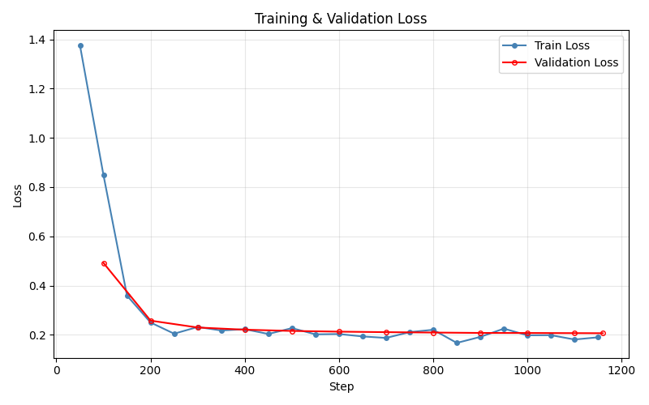
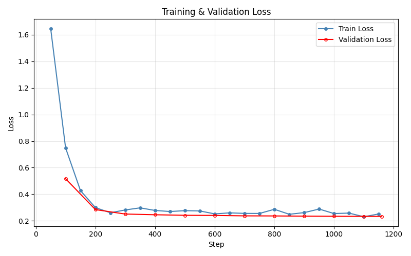

# Decoding di BLOB SQLite
Fine-tuning LoRA su LLM compatti per la decodifica automatica di campi BLOB contenuti in database SQLite di applicazioni mobili.

## Fine-tuning di Qwen2.5 7B

### Configurazione di Training 

| Parametro | Valore |
|---|---|
| Max sequence length | 7000 |
| LoRA rank (r) | 8 |
| LoRA alpha | 16 |
| LoRA dropout | 0.05 |
| Target modules | q_proj, k_proj, v_proj, o_proj |
| Epochs | 2 |
| Batch size | 8 (2 × 4 accumulation steps) |
| Optimizer | AdamW |
| Precision | bf16 |

### Valutazione (Base Model)

Accuratezza: percentuale di risposte corrette rispetto alla ground truth.
| Tipo di task | Test (in-distribution) | Test OOD (out-of-distribution) |
|---|---|---|
| Format classification | 4.44% | 4% |
| Validation judgment | 67.05% | 62.86% |
| Refusal | 0% | 0% |

Valutazione strutturale e funzionale: punteggio medio (in scala 0-5) che misura la qualità dell'output generato in base alla correttezza nell'esecuzione del codice, la capacità di generalizzazione su BLOB diversi e la correttezza dei campi.
| Tipo di task | Test (in-distribution) | Test OOD (out-of-distribution) |
|---|---|---|
| Decoder synthesis | 0.13/5 | 0.17/5 |
| BLOB to JSON | 1.02/5 | 0.89/5 |

### Valutazione (Fine-Tuned Model)

Accuratezza:
| Tipo di task | Test (in-distribution) | Test OOD (out-of-distribution) |
|---|---|---|
| Format classification | 100% | 100% |
| Validation judgment | 71.59% | 66.67% |
| Refusal | 100% | 100% |

Valutazione strutturale e funzionale:
| Tipo di task | Test (in-distribution) | Test OOD (out-of-distribution) |
|---|---|---|
| Decoder synthesis | 3.7/5 | 3.56/5 |
| BLOB to JSON | 4.02/5 | 4.41/5 |

## Fine-tuning di Gemma3 4B

### Configurazione di Training 

| Parametro | Valore |
|---|---|
| Max sequence length | 7500 |
| LoRA rank (r) | 8 |
| LoRA alpha | 16 |
| LoRA dropout | 0.05 |
| Target modules | q_proj, k_proj, v_proj, o_proj |
| Epochs | 2 |
| Batch size | 8 (2 × 4 accumulation steps) |
| Optimizer | AdamW |
| Precision | bf16 |

### Valutazione (Base Model)

Accuratezza: percentuale di risposte corrette rispetto alla ground truth.
| Tipo di task | Test (in-distribution) | Test OOD (out-of-distribution) |
|---|---|---|
| Format classification | 0% | 0% |
| Validation judgment | 39.77% | 40.28% |
| Refusal | 89.19% | 27.78% |

Valutazione strutturale e funzionale: punteggio medio (in scala 0-5) che misura la qualità dell'output generato in base alla correttezza nell'esecuzione del codice, la capacità di generalizzazione su BLOB diversi e la correttezza dei campi.
| Tipo di task | Test (in-distribution) | Test OOD (out-of-distribution) |
|---|---|---|
| Decoder synthesis | 0.18/5 | 0.06/5 |
| BLOB to JSON | 0.97/5 | 0.98/5 |

### Valutazione (Fine-Tuned Model)

Accuratezza:
| Tipo di task | Test (in-distribution) | Test OOD (out-of-distribution) |
|---|---|---|
| Format classification | 100% | 100% |
| Validation judgment | 62.5% | 65.28% |
| Refusal | 100% | 100% |

Valutazione strutturale e funzionale:
| Tipo di task | Test (in-distribution) | Test OOD (out-of-distribution) |
|---|---|---|
| Decoder synthesis | 3.7/5 | 3.55/5 |
| BLOB to JSON | 3.95/5 | 4.00/5 |